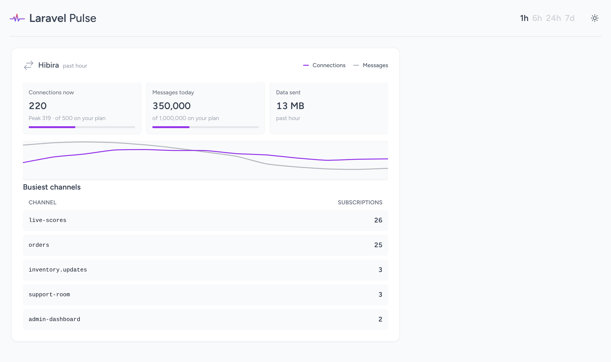

# Hibira card for Laravel Pulse

[](https://github.com/hibira-io/pulse/actions/workflows/ci.yml)

A [Laravel Pulse](https://pulse.laravel.com) card for apps that broadcast
with [Hibira](https://hibira.io). Next to your queues and slow requests you
see:

- **Connections now** and the period's peak, against your plan's limit.
- **Messages today**, against your plan's daily limit.
- **Data sent** in the selected period.
- A chart of connections and messages over 1 hour, 6 hours, 24 hours or 7 days,
  following Pulse's period picker.
- **Busiest channels** right now, by subscriber count.



Laravel 10 to 13, PHP 8.1+, Pulse 1.x.

## Install

```sh
composer require hibira-io/pulse
```

Create a personal API token with **read** access at
[hibira.io/portal/api-tokens](https://hibira.io/portal/api-tokens) (you can
restrict it to one app) and add it to `.env`:

```dotenv
HIBIRA_API_TOKEN=hkb_pat_...
HIBIRA_APP_ID=...      # already there if you broadcast with hibira-io/laravel
HIBIRA_APP_KEY=...     # optional: key and secret turn on the channel list
HIBIRA_APP_SECRET=...
```

Then add the card to your Pulse dashboard
(`resources/views/vendor/pulse/dashboard.blade.php`; run
`php artisan vendor:publish --tag=pulse-dashboard` if you don't have it yet):

```blade
<x-pulse>
    <livewire:hibira.usage cols="6" rows="2" />

    <livewire:pulse.servers cols="full" />
    ...
</x-pulse>
```

`cols`, `rows`, `expand` and `class` work as on Pulse's own cards.

## How it reads your numbers

The card doesn't record anything into Pulse's tables. Each render asks Hibira:

- `GET https://hibira.io/api/v1/apps/{id}/usage/recent` (5-minute slots) and
  `/usage` (daily totals and your plan's limits), with the API token.
- `GET /apps/{id}/channels?info=subscription_count` on the Channels HTTP API,
  signed with your app key and secret, for the busiest channels.

A reading is cached for 60 seconds, and the card refreshes every 30 seconds
while the dashboard is open. A wrong token or an unreachable API shows as a
message on the card, never as an exception on the dashboard.

## Configuration

Everything has an `.env` setting; publish the file only if you prefer:

```sh
php artisan vendor:publish --tag=hibira-pulse-config
```

| Setting | `.env` | Default |
| --- | --- | --- |
| `token` | `HIBIRA_API_TOKEN` | |
| `app_id`, `key`, `secret` | `HIBIRA_APP_ID`, `HIBIRA_APP_KEY`, `HIBIRA_APP_SECRET` | |
| `host`, `port`, `scheme` | `HIBIRA_HOST`, `HIBIRA_PORT`, `HIBIRA_SCHEME` | `ws.hibira.io`, `443`, `https` |
| `cache_seconds` | `HIBIRA_PULSE_CACHE_SECONDS` | `60` |
| `channels` (how many to list, `0` hides the list) | `HIBIRA_PULSE_CHANNELS` | `10` |

The card's texts follow your app locale in English, 日本語, 한국어, 繁體中文,
简体中文, ไทย and Tiếng Việt (`php artisan vendor:publish --tag=hibira-pulse-lang`
to change them).

## Related packages

- [hibira-io/laravel](https://github.com/hibira-io/laravel): the broadcasting
  driver, `hibira:install`, push notifications and waiting rooms.
- [hibira-io/livewire](https://github.com/hibira-io/livewire): who's here,
  batch progress and connection status components.
- [hibira-io/laravel-live-chat](https://github.com/hibira-io/laravel-live-chat):
  the Hibira Live Chat widget for Laravel.

## 中文摘要

`hibira-io/pulse` 是 Laravel Pulse 的 Hibira 卡片：在 Pulse 面板上显示当前连接数与峰值（对照套餐上限）、今日消息数（对照每日上限）、所选时段的发送数据量、连接与消息的走势图，以及此刻订阅人数最多的频道。安装后在 `.env` 设置只读的个人 API token（`HIBIRA_API_TOKEN`）和 `HIBIRA_APP_ID`，填了 `HIBIRA_APP_KEY`/`HIBIRA_APP_SECRET` 才会显示频道列表；然后在 Pulse 面板加入 `<livewire:hibira.usage cols="6" rows="2" />`。数据每 60 秒缓存一次，不写入 Pulse 的数据表；token 错误或 API 不可达时只在卡片上显示提示。界面文字支持 7 种语言。

## License

MIT
